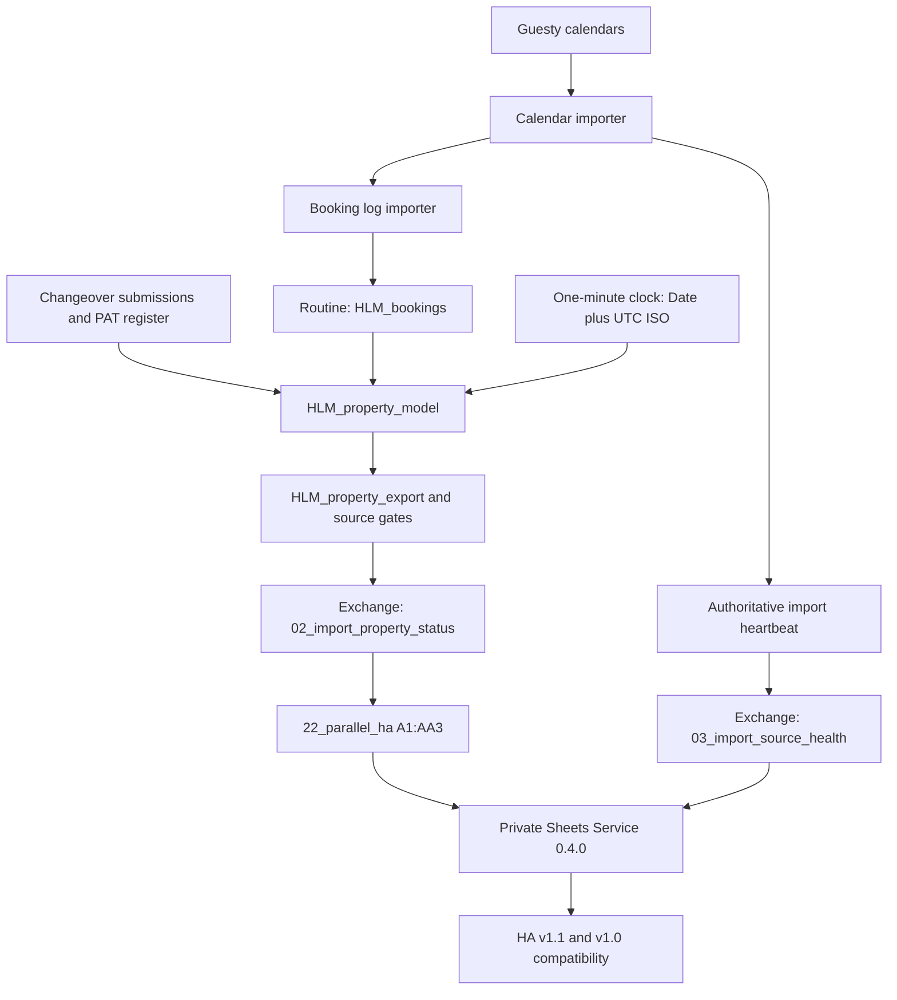

# HLM Sheets Service architecture — 0.4.0

This describes the 0.4.0 runtime design. Actual deployment evidence and recovery
steps are recorded in the main HLM repository's 11 October cutover session.

The service reads one property source for both contract versions. Exactly
Skysail and Crossjack are required; UTC evaluation age must be between -120
and 900 seconds. Existing source gates surface invalid inputs instead of
silently publishing vacant or ready states. Operational date calculations
still use Europe/London and the original 10:00/16:00 boundaries.

## Freshness boundaries

The clock is owned by sailcottagesha@gmail.com, whose Routine Editor access
must be retained permanently. B2 contains a real Date and B13 UTC ISO text.
Export Z2:Z3 uses B13 through the existing gates, with milliseconds stripped
for compatibility with the previous audit parser.

The hourly calendar importer records attempts, successes, errors, records,
receipt time and generation ID. A failed attempt retains its previous success
and snapshot. Missing source modification time stays unknown. The service
reads this separately and allows a maximum success age of 5,400 seconds.
These two clocks do not establish that the booking-log importer consumed the
same generation. `freshness_verified` and `booking_transport_verified` remain
false until that additional evidence is available. Never use HTTP 200 or
evaluation_fresh alone as proof of end-to-end source freshness.

## Diagnostics and historical records

The authenticated `/api/v1.1/health` route reports per-layer diagnostics.
The persistent audit records evaluation health plus separate importer details
every five minutes for 90 days. Historical matched/different records remain;
new production records do not compare a feed with itself or the retired source.
Model audit status is distinct from full upstream health.

The old publication tabs remain available for recovery and existing non-HA
uses. The old public HA Apps Script deployment is archived. Non-HA booking,
form, PAT and changeover operations must not be retired during this migration.

## Trust and event-write boundaries

The read service and health routes retain bearer authentication and private
network access. Read-only Google credentials do not grant event-write access.
Private diagnostic values stay in runtime storage and authenticated responses,
never public endpoints or Git. The operator controls diagnostic retention and
the privacy policy.

`POST /api/v1/events`, its separate writer identity/token, the 33-column
contract, idempotency behavior and `30_hlm_events` remain unchanged. No new
host port, proxy, credential or internet exposure is introduced.
